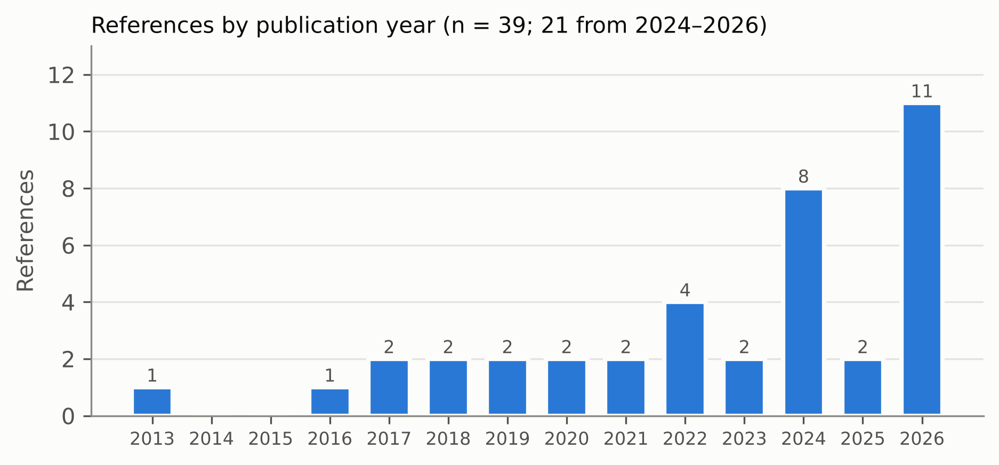
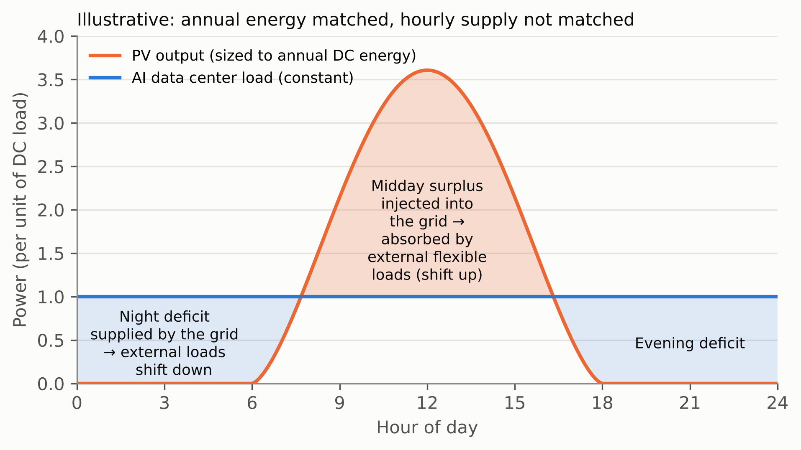
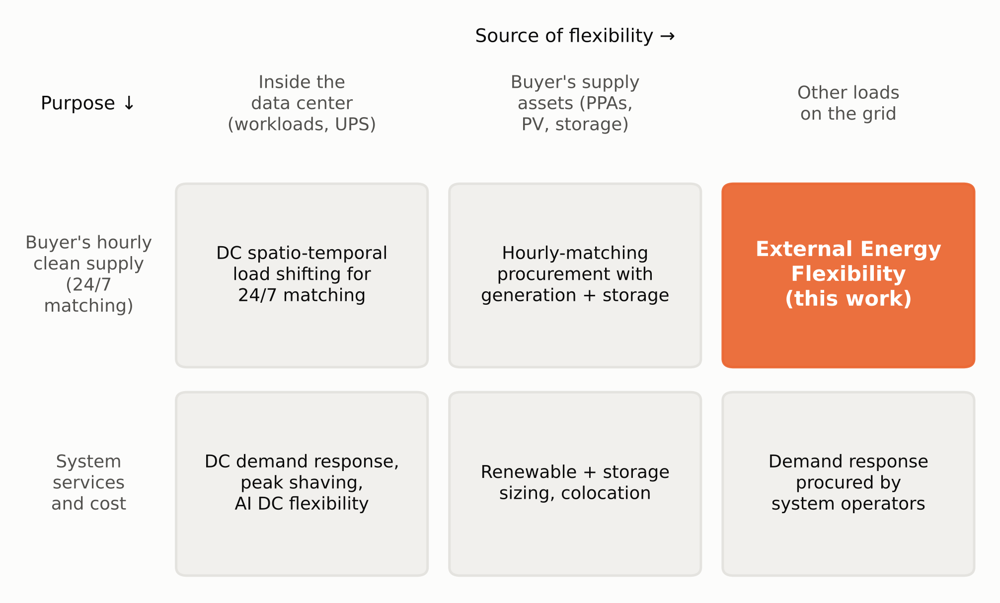

# Chapter 2 — Literature Review (Draft v1)

> Status: full first draft covering all seven themes, based on 38 sources read in full or in their key sections. Figures 2.1–2.3 are generated by `figures/make_ch2_figures.py`. Citations in IEEE numeric style. Reference numbers follow the order in which sources were added to the draft; they will be renumbered by order of first appearance when converted to LaTeX/BibTeX. **Every claim must be checked by the author against the cited paper before submission.** Items marked *[TODO]* need an additional source.

---

## 2.1 Introduction

Electricity demand from data centers is growing rapidly, and the newest facilities, dedicated to training and serving artificial-intelligence (AI) models, add large blocks of nearly constant load to power systems [1], [8], [24]. Three research streams address how such loads can be reconciled with decarbonizing grids. The first studies the *flexibility of the data center itself*: whether its computing workload, servers, cooling or backup assets can be scheduled to support the grid. The second studies *clean-energy procurement*: how a large consumer can claim, and actually cause, low-carbon supply. The third, *demand-side flexibility in the power system*, investigates how other consumers' loads can be shifted to balance variable renewable generation.

This chapter first reviews the background: AI data center energy demand (Section 2.2) and the configurations used to supply data centers (Section 2.3). It then reviews the three streams (Sections 2.4–2.6), the Saudi context (Section 2.7) and the methods used to assess supply options against multiple objectives (Section 2.8). Section 2.9 discusses the closest related work and Section 2.10 states the research gap: although each stream is mature, their intersection—using the flexibility of *other* grid-connected loads to deliver hourly clean supply to an *inflexible* AI data center—has not been studied. This gap motivates the concept of **External Energy Flexibility (EEF)** proposed in this dissertation.

The review draws on 39 references identified through Crossref and IEEE Xplore searches and backward citation tracking. As Fig. 2.3 shows, about half were published in 2024–2026, reflecting how recently AI data center loads have become a power-system concern.

*Fig. 2.3. Distribution of the references reviewed in this chapter by publication year.*

## 2.2 AI Data Center Energy Demand

Data centers consumed an estimated 240–340 TWh of electricity worldwide in 2022, about 1–1.3% of global demand [22]*[secondary citation: replace with the IEA source once obtained]*. In the United States, data center consumption reached 176 TWh in 2023, or 4.4% of national electricity use, and is projected to reach roughly 325–580 TWh by 2028—6.7–12.0% of forecast U.S. consumption—driven largely by AI-accelerated servers; at an average capacity utilization of 50%, this corresponds to 74–132 GW of data center power demand [1]. Some utilities report grid-connection waiting times of up to 7–10 years for such loads, as reported in [8]. Grid connections can now take more than five years in the United States and Europe, driving a trend toward "grid defection," in which data centers are fully or partly supplied by local microgrids with dedicated generation [28]. Through the early and mid-2010s, U.S. data center electricity use remained nearly constant despite rapid industry growth, owing to efficiency gains such as improved cooling and power management, higher server utilization and reduced idle power; growth has since accelerated with the rapid emergence of AI hardware [1].

Estimates themselves are uncertain. A review of 258 data center energy estimates from 46 publications (2007–2021) found that only 31% of the 676 underlying sources were peer-reviewed, that many lacked clear methods and data provenance, and that estimates relied heavily on private datasets [29]. The same review notes that unexpected data center demand is already constraining grid operators, for example in Amsterdam and London [29].

**Load shape.** AI data centers draw power that is high and nearly constant on hourly timescales. In a production trace of 155,410 GPUs, median facility demand was 55.8 MW and only a small fraction of it was curtailable (Section 2.4) [26], and national energy models assume that AI servers used for training operate 80% of the time [1]. Facility-level consumption also includes cooling and power-conversion overheads, summarized by power usage effectiveness (PUE). Simulations across U.S. climates show that PUE varies widely with facility type and cooling system, with the highest values for poorly operated facilities in hot, humid climates [1]—relevant to data centers in the Gulf.

**Implication for this work.** Because demand forecasts are uncertain and AI facilities are large and inflexible, this dissertation evaluates supply options for a range of data center sizes rather than a single forecast, and treats the data center load as constant.

## 2.3 Supply Configurations for Data Centers

Three supply configurations dominate practice and literature.

**Direct grid connection.** The data center buys all its electricity from the grid, inheriting the grid's reliability and carbon intensity. Grid-interactive uninterruptible power supplies (UPS) and backup generators provide ride-through, and UPS batteries can additionally provide fast frequency response, with full activation within about a second [7].

**On-site or colocated renewables with storage.** Renewable-colocated AI data centers co-optimize on-site generation with workload scheduling and market participation [8], and integrated designs combine photovoltaics (PV) and energy storage with other co-located loads [22]. Designing such systems is a sizing problem. A review of renewable-storage sizing shows that empirical battery sizing tends to over- or under-estimate performance and waste resources, and identifies battery output stabilization and dynamic energy matching as core design principles [30]. Classic reliability-constrained methods size PV arrays and battery banks to meet a target loss of power supply probability (LPSP), such as 1%, and then compare life-cycle costs [31]; multi-objective approaches trade annualized cost against loss-of-load and loss-of-energy expectations [32] (Section 2.8). In Saudi Arabia, simulation-based sizing has been applied to PV–wind–battery systems, for example for an electric-vehicle charging station in Khobar [33]. Storage, however, becomes the dominant cost as the renewable share rises: for an industrial consumer, storage requirements grow non-linearly beyond about 80% renewable supply [15].

**Contracted renewable supply.** Large consumers procure off-site renewable energy through power purchase agreements and certificates while remaining physically supplied by the grid; whether such procurement is matched annually or hourly is reviewed in Section 2.5 [10], [11], [14]–[16].

Data center siting studies increasingly weight renewable potential: a multi-criteria framework ranks candidate data center sites by solar and wind potential and infrastructure access [34], and water stress is emerging as an additional sustainability criterion for AI data centers, since many solar-rich regions are also water-stressed [35].

**Implication for this work.** The two physical baselines—direct grid connection and renewables with storage—define the cost and sustainability bounds against which EEF is compared, and the storage-cost escalation at high renewable shares is the problem EEF seeks to avoid.

## 2.4 Internal Flexibility of Data Centers

The established view in the literature is that data centers are flexible loads. Early work showed that combining workload shifting with local generation lets a data center avoid coincident-peak charges, saving up to 40% of electricity costs under one utility's coincident-peak tariff compared with either measure alone [2]. Peak shaving was later formulated as joint control of delay-tolerant workload classes and on-site batteries, validated with Google traces [6], and demand response was co-optimized with server provisioning and power procurement from renewables and storage in a two-stage stochastic program [5]. A comprehensive review of Internet data centers (IDCs) in demand response organizes the field around load modeling, spatial and temporal workload regulation, economic mechanisms and program participation [3], and a bottom-up IDC load model couples multiple regulation methods—geographic workload migration, temporal deferral and server control—for hierarchical grid control [4]. Beyond energy-scale services, grid-interactive UPS can provide fast frequency response (full activation within about a second), while balancing over hours to days is attributed to other energy-intensive assets [7].

For AI data centers specifically, recent studies co-optimize AI workload scheduling with colocated renewables and market participation [8] or embed deferrable AI load in capacity-expansion models with network constraints [24]. Shifting computation in time and across geographically distributed sites has also been used to pursue hourly clean-energy matching [9], and representing data center load as firm, flexible or interruptible tiers shows that the value of flexibility depends on the host grid—for example, shifting load into midday solar hours enables additional solar and avoids gas and battery capacity [27].

**Common assumption.** All of these studies draw flexibility from *inside* the data center: its workloads, servers, UPS or batteries. This assumption is increasingly questioned for AI facilities. An analysis of a 155,410-GPU production trace found that immediately curtailable load averages only about 6.35% of median facility power, that dependable relief shrinks as event duration grows, and that the production scheduler exposes almost no additional delay-based capacity [26]. Large AI training and inference facilities are therefore better described as nearly constant loads with very limited internal flexibility—precisely the class of load for which internal-flexibility solutions are least effective.

## 2.5 Clean-Energy Matching for Large Consumers

Corporate buyers traditionally claim renewable supply through *annual (volumetric) matching*: procuring renewable energy or certificates equal to annual consumption. Evidence shows this overstates real mitigation. Excluding certificate-based claims, the combined 2015–2019 scope 2 trajectories of companies with science-based targets are no longer aligned with 1.5 °C, and, if the trend continues, 42% of committed scope 2 reductions will not result in real-world mitigation [12]. Annual-average emission accounting can itself bias inventories by up to ±35% where grid carbon intensity varies by hour and season [13]. Fig. 2.1 illustrates the problem for a constant data center load: renewable output sized to match the load's energy over the period produces a midday surplus and a night-time deficit, so the load is still supplied largely by the grid when the sun is down. System-level capacity-expansion studies find that annually matched procurement has negligible emission benefits, whereas *hourly (24/7) matching* reduces system emissions and accelerates advanced clean technologies, at a cost premium [10], [11]; the premium is small for 90–95% hourly matching but high for 100% matching with solar, wind and batteries alone [11].

How hourly matching is achieved is therefore central. Existing studies rely on three means: (i) a portfolio of procured clean generators, optimized to reach a target hourly carbon-free energy (CFE) score at least cost under uncertainty [16]; (ii) dedicated storage and firm resources, sized with stochastic and risk-averse (CVaR) planning for data center and industrial load profiles [14] or combined with direct power purchase agreements and market purchases [15]; and (iii) the buyer's *own* demand flexibility, including spatio-temporal shifting across its data centers [9], [10]. Storage-based matching becomes expensive at high matching levels: for an industrial consumer, direct-PPA procurement is infeasible without storage beyond roughly 20% renewable share, and storage requirements grow non-linearly beyond about 80%, sharply raising cost [15].

*Fig. 2.1. Illustrative clear-sky day: a constant AI data center load and PV output sized to the same daily energy. Shaded areas show the midday surplus (orange) and the night and evening deficits (blue). Annual matching balances the areas; hourly matching requires shifting energy between them. Under EEF, external flexible loads increase consumption during the surplus and reduce it during the deficits.*

**Common assumption.** Hourly matching is achieved with assets the buyer owns or contracts on the *supply* side, or with the buyer's *own* load flexibility. The flexibility of *other* consumers on the grid is not used as a means of matching.

## 2.6 Demand-Side Flexibility in the Power System

Demand response (DR) is a well-established resource for integrating variable renewables, comprising incentive- and price-based programs, enabling technologies and measurement against customer *baselines* [17]. Flexibility is typically procured by system or grid operators, either directly from consumers or through service providers (aggregators); game-theoretic analysis shows that a direct channel can mitigate double marginalization and expand the DR market [18]. Specific industrial loads have been characterized as flexibility resources: desalination plants can adjust power while meeting water requirements when given incentives [20], and their technical and economic flexibility intervals can be quantified with adaptive robust optimization [19]. Aggregator-based shifting of flexible load toward solar hours has been studied for voltage regulation in PV-rich distribution systems [21]. More broadly, highly renewable grids require new flexibility together with policy and regulatory change [25].

**Common assumption.** External flexibility is procured *by the system operator* for *system services* (balancing, peak shaving, voltage). It is not procured *by a large consumer* to firm its own renewable supply.

## 2.7 The Saudi Arabian Context

Saudi Arabia targets 50% of its electricity from renewable sources by 2030; an expert-based multi-criteria assessment ranked solar as the most suitable resource, with cost-effectiveness the dominant criterion (31%), followed by low intermittency (24%) and resource potential (22%) [36]. Utility-scale PV siting across the Kingdom has been mapped with GIS and the analytic hierarchy process using real climatology and land-use constraints [37].

The growth of solar reshapes system needs. A national assessment projects that between 2025 and 2030 the depth of the daily net-load "duck curve" will triple and maximum one-hour ramping requirements will rise by a factor of 3.5–5.5; it estimates a gross industrial DR potential of 7.1–29.9 GW by 2030, sufficient to meet peak-shaving needs, but notes that the role of DR remains under-defined in the Kingdom's single-buyer market and calls for coordinated action among the Saudi Power Procurement Company (SPPC), the National Grid (NGSA), utilities and aggregators [23]. Desalination, essential to Saudi water supply, has been studied as a DR resource [19], [20], and the coexistence of data centers and desalination on Saudi and Gulf coasts has motivated integrated designs [22].

Emission accounting is a critical issue. A Saudi power-system model using the marginal-emission method found that, in most regions and under the 2017 generation mix, the marginal generator largely does not change with the timing of load, so a time-of-use pricing mechanism would not promote emission reduction [38]. Load shifting therefore reduces emissions in Saudi Arabia mainly when midday marginal supply becomes renewable—for example when solar would otherwise be curtailed—a condition that becomes more frequent as solar penetration rises and the duck curve deepens [23] (our inference, to be tested in this dissertation).

**Implication for this work.** The Saudi grid is a strong case for EEF: rapidly growing solar, a large pool of potentially flexible industrial and desalination load, and an undefined market role for flexibility. It also requires the sustainability assessment to use a future high-solar grid and to report both average and marginal emission effects.

## 2.8 Methods for Multi-Objective Assessment of Supply Options

**Reliability indices.** Supply-system studies quantify reliability with the loss of power supply probability (LPSP) [31], the loss of load expectation (LOLE) and the loss of energy expectation (LOEE) [32], and energy-reliability indicators such as the fraction of load served by on-site renewables [39].

**Multi-objective optimization.** Cost–reliability trade-offs are explored with Pareto fronts, for example by multi-objective particle swarm optimization that minimizes annualized cost, LOLE and LOEE over a 20-year horizon including component outages [32]. An alternative energy-reliability-constrained approach lets the analyst constrain some indicators while optimizing others, depending on the application, and has been compared with the classic Pareto-front method [39].

**Uncertainty.** Hourly matching and supply planning under weather and price uncertainty use two-stage stochastic programming with risk measures such as conditional value-at-risk [14], chance constraints on target matching scores [16], two-stage stochastic programs solved with decomposition [5], [22], and adaptive robust optimization for flexibility quantification [19].

**Multi-criteria decision-making (MCDM).** When alternatives must be ranked under several criteria with stakeholder weights, studies combine the analytic hierarchy process (AHP) with TOPSIS [36], GIS-based AHP [37] or fuzzy SWARA–VIKOR, including for data center site selection [34].

**Implication for this work.** The three pillars—reliability, cost and sustainability—can be handled by constraining reliability (e.g., data center availability) while tracing cost–emission Pareto fronts, and the four supply configurations can then be ranked with AHP-TOPSIS under alternative stakeholder weightings.

## 2.9 Closest Related Work

The study closest to this dissertation integrates a data center with a seawater desalination plant [22]. A flexible data center, a reverse-osmosis plant, photovoltaics and storage are co-located behind one substation; data center waste heat preheats seawater, lowering desalination energy use, and investment and operation are co-optimized with two-stage stochastic programming, reducing annualized cost by 86.5% (17% from heat synergy). The work is motivated by the coexistence of data centers and desalination on arid coasts such as Saudi Arabia's.

EEF differs from [22] in five respects: (1) the data center in [22] is *flexible* (workload scheduling within daily task totals), whereas EEF targets an *inflexible* AI data center; (2) [22] couples one *co-located, co-planned* plant, whereas EEF draws on a *portfolio of existing grid-connected* flexible loads; (3) the coupling in [22] is *physical* (waste heat), whereas EEF's is *contractual*, through the grid; (4) [22] minimizes cost, whereas EEF targets *hourly clean-energy matching* jointly with reliability and cost; and (5) EEF is benchmarked against direct grid supply, renewable-plus-storage supply and annual matching, and analyzed for saturation as data center capacity grows. Similarly, studies of renewable-colocated AI data centers [8] and spatio-temporal 24/7 matching [9] depend on internal workload flexibility that constant-load AI facilities lack [26].

## 2.10 Research Gap

Fig. 2.2 maps the reviewed literature by the source of flexibility and its purpose, and Table 2.1 details the positioning. Every cell except one is occupied: no study uses the flexibility of other loads on the grid to provide a buyer's hourly clean supply.

*Fig. 2.2. Positioning of this research. Columns show where flexibility comes from; rows show what it is used for. Bracketed numbers are references in this chapter.*

*Table 2.1. Positioning of this work relative to the literature.*

| Stream | Flexibility source | Who procures it | Purpose | Applicable to inflexible AI DC? |
|---|---|---|---|---|
| Internal DC flexibility [2]–[9], [24], [27] | DC workloads, servers, UPS, batteries | DC operator | Cost, DR, peak shaving, 24/7 CFE | Limited [26] |
| Renewables + storage supply [15], [30]–[33] | On-site/contracted storage | DC / buyer | Self-supply, reliability | Costly at high shares [15] |
| Hourly clean matching [9]–[11], [14]–[16] | Procured generation, storage, own load | Buyer | 24/7 CFE | Only via costly storage [15] |
| Grid demand flexibility [17]–[21], [23] | Other consumers' loads | System operator / aggregator | System balancing | Not linked to a buyer's supply |
| DC–desalination coupling [22] | Co-located plant + flexible DC | Integrated owner | Cost (heat synergy) | No (assumes flexible DC) |
| **This work (EEF)** | **Portfolio of existing external loads** | **DC via contractual framework** | **Hourly matching + reliability + cost** | **Yes** |

No study was found that (i) treats a constant-load AI data center as inflexible; (ii) pairs it with grid-injected PV sized to its annual consumption; and (iii) achieves hourly clean-energy matching by contracting the flexibility of external loads already connected to the grid—evaluated jointly on reliability, cost and sustainability against direct grid supply, renewable-plus-storage supply and annual matching, and analyzed for the saturation of available flexibility. Addressing this gap is the objective of this dissertation.

---

## References

[1] A. Shehabi, S. Smith, A. Hubbard et al., "2024 United States data center energy usage report," Lawrence Berkeley National Laboratory, Berkeley, CA, USA, Rep. LBNL-2001637, Dec. 2024, doi: 10.71468/P1WC7Q.
[2] Z. Liu, A. Wierman, Y. Chen et al., "Data center demand response: Avoiding the coincident peak via workload shifting and local generation," *Performance Evaluation*, vol. 70, no. 10, pp. 770–791, 2013, doi: 10.1016/j.peva.2013.08.014.
[3] M. Chen, C. Gao, M. Song et al., "Internet data centers participating in demand response: A comprehensive review," *Renew. Sustain. Energy Rev.*, vol. 117, Art. no. 109466, 2020, doi: 10.1016/j.rser.2019.109466.
[4] M. Chen, C. Gao, M. Shahidehpour et al., "Internet data center load modeling for demand response considering the coupling of multiple regulation methods," *IEEE Trans. Smart Grid*, vol. 12, no. 3, pp. 2060–2076, 2021, doi: 10.1109/TSG.2020.3048032.
[5] S. Kwon, L. Ntaimo, and N. Gautam, "Demand response in data centers: Integration of server provisioning and power procurement," *IEEE Trans. Smart Grid*, vol. 10, no. 5, pp. 4928–4938, 2019, doi: 10.1109/TSG.2018.2871125.
[6] M. Dabbagh, B. Hamdaoui, A. Rayes et al., "Shaving data center power demand peaks through energy storage and workload shifting control," *IEEE Trans. Cloud Comput.*, vol. 7, no. 4, pp. 1095–1108, 2019, doi: 10.1109/TCC.2017.2744623.
[7] J. Paananen, "Grid-interactive data centers enabling energy transition," *IEEE Electrific. Mag.*, vol. 11, no. 3, pp. 26–34, 2023, doi: 10.1109/MELE.2023.3291195.
[8] S. Li, L. Tong, and T. D. Mount, "Energy management for renewable-colocated artificial intelligence data centers," in *Proc. IEEE PES Int. Meeting*, 2026, pp. 1–5, doi: 10.1109/PESIM67009.2026.11439004.
[9] I. Riepin, T. Brown, and V. M. Zavala, "Spatio-temporal load shifting for truly clean computing," *Adv. Appl. Energy*, vol. 17, Art. no. 100202, 2025, doi: 10.1016/j.adapen.2024.100202.
[10] Q. Xu, W. Ricks, A. Manocha et al., "System-level impacts of voluntary carbon-free electricity procurement strategies," *Joule*, vol. 8, no. 2, pp. 374–400, 2024, doi: 10.1016/j.joule.2023.12.007.
[11] I. Riepin and T. Brown, "On the means, costs, and system-level impacts of 24/7 carbon-free energy procurement," *Energy Strategy Rev.*, vol. 54, Art. no. 101488, 2024, doi: 10.1016/j.esr.2024.101488.
[12] A. Bjørn, S. M. Lloyd, M. Brander et al., "Renewable energy certificates threaten the integrity of corporate science-based targets," *Nat. Clim. Change*, vol. 12, no. 6, pp. 539–546, 2022, doi: 10.1038/s41558-022-01379-5.
[13] G. J. Miller, K. Novan, and A. Jenn, "Hourly accounting of carbon emissions from electricity consumption," *Environ. Res. Lett.*, vol. 17, no. 4, Art. no. 044073, 2022, doi: 10.1088/1748-9326/ac6147.
[14] Y. Hwang, J. Lee, Y. Park et al., "Risk-aware planning for corporate renewable electricity procurement under hourly matching," *Energy*, vol. 367, Art. no. 142953, 2026, doi: 10.1016/j.energy.2026.142953.
[15] Y. J. Lee, E. J. Choi, and S. W. Kim, "Integrated procurement strategies for corporate renewable electricity: Combinations of direct PPA, energy storage, and market participation," *J. Electr. Eng. Technol.*, vol. 21, no. 4, pp. 3187–3198, 2026, doi: 10.1007/s42835-026-02807-8.
[16] M. Ludkovski, S. Mouti, and G. Swindle, "Least-cost structuring of 24/7 carbon-free electricity procurements," in *Proc. IEEE PES General Meeting*, 2024, pp. 1–5, doi: 10.1109/PESGM51994.2024.10688843.
[17] N. G. Paterakis, O. Erdinç, and J. P. S. Catalão, "An overview of demand response: Key-elements and international experience," *Renew. Sustain. Energy Rev.*, vol. 69, pp. 871–891, 2017, doi: 10.1016/j.rser.2016.11.167.
[18] X. Fei, C. Lyu, and Y. Ding, "Energy flexibility procurement strategy in competitive demand response markets: Dual-channel supply chain perspective," *Energy Econ.*, vol. 161, Art. no. 109542, 2026, doi: 10.1016/j.eneco.2026.109542.
[19] Z. Wu, X. Zhao, Y. Mao et al., "Flexibility quantification of desalination plants for demand response: An adaptive robust optimization methodology," *Appl. Energy*, vol. 373, Art. no. 123835, 2024, doi: 10.1016/j.apenergy.2024.123835.
[20] K. Alshehri and A. T. Al-Awami, "On the interplay between water and power grids: Desalination plants for demand response," in *Proc. IEEE PES General Meeting*, 2023, pp. 1–5, doi: 10.1109/PESGM52003.2023.10252990.
[21] I. Alsaleh, "Model-free reinforcement learning for demand response in PV-rich distribution systems," in *Proc. Saudi Arabia Smart Grid Conf. (SASG)*, 2022, pp. 1–5, doi: 10.1109/SASG57022.2022.10200928.
[22] R. Yang, C. Konstantinou, and Y. Hou, "Enabling grid-interactive data center-desalination coordination through thermo-electric coupling-based waste heat utilization," *Appl. Energy*, vol. 408, Art. no. 127428, 2026, doi: 10.1016/j.apenergy.2026.127428.
[23] M. Petitet, S. Wachon, and K. Khedim, "Evaluation and role of industrial demand response in Saudi Arabia," KAPSARC Discussion Paper, 2026, doi: 10.30573/KS--2026-DP17.
[24] Y. Chen and X. Zheng, "To defer or to shift? The role of AI data center flexibility on grid interconnection," in *Proc. ACM Sustainability Week (e-Energy)*, 2026, pp. 322–327, doi: 10.1145/3765611.3815593.
[25] R. O'Connell, A. Phadke, M. O'Boyle et al., "Carbon-free energy: How much, how soon?," *IEEE Power Energy Mag.*, vol. 19, no. 6, pp. 67–76, 2021, doi: 10.1109/MPE.2021.3104130.
[26] M. Li et al., "Beyond scalar flexibility: From eligible AI workloads to dependable load relief," arXiv:2609.05406, 2026.
[27] S. Khanal, G. Roh, B. Yao et al., "Shift or curtail? How much data-center flexibility is worth depends on the host power grid," arXiv:2608.19622, 2026.
[28] T. Morstyn, Y. Zhou, and I. Whitfield, "Multiscale grid intelligence to fight artificial intelligence data center grid defection: Unlocking a faster, cheaper, and cleaner on-grid AI rollout," *IEEE Energy Sustain. Mag.*, vol. 2, no. 1, 2026, doi: 10.1109/ESM.2025.3628276. *(open-access author version, Oxford Research Archive)*
[29] D. Mytton and M. Ashtine, "Sources of data center energy estimates: A comprehensive review," *Joule*, vol. 6, no. 9, pp. 2032–2056, 2022, doi: 10.1016/j.joule.2022.07.011.
[30] Y. Zhou, "Renewable-storage sizing approaches for centralized and distributed renewable energy—A state-of-the-art review," *J. Energy Storage*, vol. 100, Art. no. 113688, 2024, doi: 10.1016/j.est.2024.113688.
[31] R. Ayop, N. M. Isa, and C. W. Tan, "Components sizing of photovoltaic stand-alone system based on loss of power supply probability," *Renew. Sustain. Energy Rev.*, vol. 81, pp. 2731–2743, 2018, doi: 10.1016/j.rser.2017.06.079.
[32] H. R. Baghaee, M. Mirsalim, G. B. Gharehpetian et al., "Reliability/cost-based multi-objective Pareto optimal design of stand-alone wind/PV/FC generation microgrid system," *Energy*, vol. 115, pp. 1022–1041, 2016, doi: 10.1016/j.energy.2016.09.007.
[33] A. S. AbdElrazek, M. Soliman, and M. Khalid, "Evaluating the techno-economic viability of a solar PV-wind turbine hybrid system with battery storage for an electric vehicle charging station in Khobar, Saudi Arabia," in *Proc. Saudi Arabia Smart Grid Conf. (SASG)*, 2024, pp. 1–10, doi: 10.1109/SASG64132.2024.11535896.
[34] E. Ayyildiz, B. Yildirim, and N. Aydin, "Location selection methodology for data center with renewable energy integration," *Renewable Energy*, vol. 250, Art. no. 123270, 2025, doi: 10.1016/j.renene.2025.123270.
[35] A. Ahmed, "A water–carbon sustainability framework for 24/7 carbon-free AI datacenter siting in the U.S.," in *Proc. IEEE PES General Meeting*, 2026, pp. 1–5, doi: 10.1109/PESGM58988.2026.11693218.
[36] A. A. Amiri, M. N. Wahid, A. S. Al-Buraiki et al., "A strategic multi-criteria decision-making framework for renewable energy source selection in Saudi Arabia using AHP-TOPSIS," *Renewable Energy*, vol. 236, Art. no. 121523, 2024, doi: 10.1016/j.renene.2024.121523.
[37] H. Z. Al Garni and A. Awasthi, "Solar PV power plant site selection using a GIS-AHP based approach with application in Saudi Arabia," *Appl. Energy*, vol. 206, pp. 1225–1240, 2017, doi: 10.1016/j.apenergy.2017.10.024.
[38] A. M. Elshurafa and N. Peerbocus, "Electric vehicle deployment and carbon emissions in Saudi Arabia: A power system perspective," *Electr. J.*, vol. 33, no. 6, Art. no. 106774, 2020, doi: 10.1016/j.tej.2020.106774.
[39] D. Mazzeo, G. Oliveti, C. Baglivo et al., "Energy reliability-constrained method for the multi-objective optimization of a photovoltaic-wind hybrid system with battery storage," *Energy*, vol. 156, pp. 688–708, 2018, doi: 10.1016/j.energy.2018.04.062.
