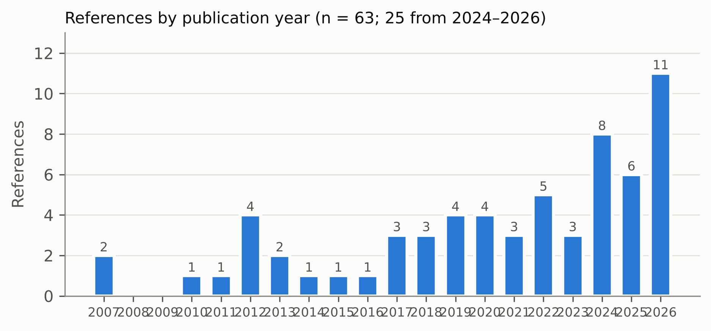
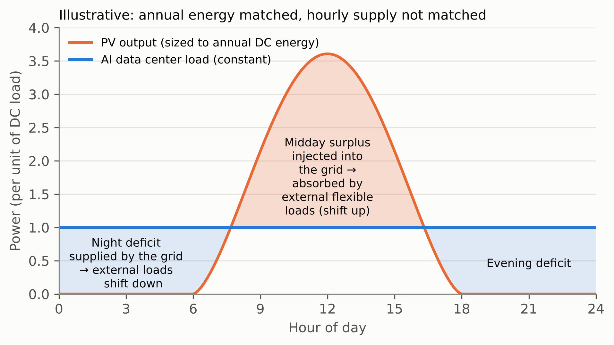
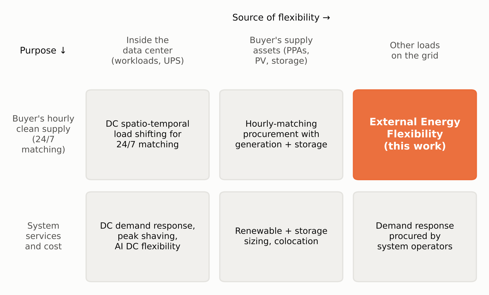

# Chapter 2 — Literature Review (Draft v2)

> Status: publication-ready draft. Generated figures: `figures/make_ch2_figures.py`. LaTeX/PDF build: `docs/thesis/`. Claim verification: `chapter2_verification.md`.

---

## 2.1 Introduction

Electricity demand from data centers is growing rapidly, and the newest facilities, dedicated to training and serving artificial-intelligence (AI) models, add large blocks of nearly constant load to power systems [1], [8], [24]. Three research streams address how such loads can be reconciled with decarbonizing grids. The first studies the *flexibility of the data center itself*: whether its computing workload, servers, cooling or backup assets can be scheduled to support the grid. The second studies *clean-energy procurement*: how a large consumer can claim, and actually cause, low-carbon supply. The third, *demand-side flexibility in the power system*, investigates how other consumers' loads can be shifted to balance variable renewable generation.

Section 2.2 describes how the literature was identified. Sections 2.3–2.5 review the background: AI data center energy demand, the reliability that data centers require, and the configurations used to supply them. Sections 2.6–2.8 review the three research streams, and Section 2.9 places them in the smart-grid context and distinguishes smart grids from microgrids. Section 2.10 covers the Saudi context and Section 2.11 the methods used to assess supply options against multiple objectives. Section 2.12 compares the studies closest to this dissertation, Section 2.13 states the research gap and Section 2.14 summarizes the chapter. The review shows that although each stream is mature, their intersection—using the flexibility of *other* grid-connected loads to deliver hourly clean supply to an *inflexible* AI data center—has not been studied. This gap motivates the concept of **External Energy Flexibility (EEF)** proposed in this dissertation.

## 2.2 Review Methodology

The review followed a structured search-and-screen procedure. Searches were run in November 2026 in Crossref, which indexes IEEE, Elsevier, Springer, ACM, IOP and MDPI publications (with an IEEE-only filter for the core themes), and in IEEE Xplore, Semantic Scholar and arXiv. Authoritative grey literature from the International Energy Agency (IEA), Lawrence Berkeley National Laboratory (LBNL), the King Abdullah Petroleum Studies and Research Center (KAPSARC), standards bodies and government agencies was added. Queries combined terms for seven themes: (1) AI data center energy demand; (2) data center reliability and supply configurations, including storage sizing; (3) internal data center flexibility and demand response; (4) clean-energy procurement and hourly (24/7) matching; (5) demand-side flexibility, its procurement and baselines; (6) multi-objective and multi-criteria assessment; and (7) the Saudi power sector. Publications from 2010 to 2026 were considered, and earlier foundational works were added through backward citation tracking.

The database searches returned 1,365 records (1,217 unique). Title and abstract screening retained about 85 records for closer assessment, of which about 45 were examined in full text. Studies were included if they (i) addressed the electricity supply or flexibility of data centers or other large loads; (ii) proposed or evaluated a means of hourly clean-energy matching; (iii) characterized demand-side flexibility resources or their procurement; or (iv) provided methods or Saudi-specific evidence used later in this dissertation. Peer-reviewed publications were preferred; preprints were included only when they reported recent evidence not yet available in journals. Ten foundational smart-grid and microgrid references (standards and surveys) were added outside the screened corpus to frame the contribution in Section 2.9. Fig. 2.1 shows the distribution of the cited references by publication year. Nearly half of the screened studies (25 of 53) were published in 2024–2026, which reflects how recently AI data center loads have become a power-system concern. The foundational smart-grid references added for Section 2.9 date from 2007–2021.

*Fig. 2.1. Distribution of the references cited in this chapter by publication year.*

## 2.3 AI Data Center Energy Demand

Data centers accounted for around 1.5% of the world's electricity consumption in 2024, or 415 TWh, and their consumption has grown by around 12% per year since 2017—more than four times faster than total electricity consumption [40]. It is projected to more than double to around 945 TWh by 2030, with AI the most important driver, and to reach about 1,200 TWh by 2035 in the IEA Base Case, within a range of 700–1,700 TWh across scenarios [40]. A typical AI-focused data center consumes as much electricity as 100,000 households, the largest under construction will consume 20 times as much, and such facilities can draw as much power as energy-intensive factories such as aluminium smelters [40]. In the United States, data center consumption reached 176 TWh in 2023, or 4.4% of national electricity use, and is projected to reach roughly 325–580 TWh by 2028—6.7–12.0% of forecast U.S. consumption—driven largely by AI-accelerated servers; at an average capacity utilization of 50%, this corresponds to 74–132 GW of data center power demand [1]. Some utilities report grid-connection waiting times of up to 7–10 years for such loads, as reported in [8]. Grid connections can now take more than five years in the United States and Europe, driving a trend toward "grid defection," in which data centers are fully or partly supplied by local microgrids with dedicated generation [28]. Through the early and mid-2010s, U.S. data center electricity use remained nearly constant despite rapid industry growth, owing to efficiency gains such as improved cooling and power management, higher server utilization and reduced idle power; growth has since accelerated with the rapid emergence of AI hardware [1].

Estimates themselves are uncertain. A review of 258 data center energy estimates from 46 publications (2007–2021) found that only 31% of the 676 underlying sources were peer-reviewed, that many lacked clear methods and data provenance, and that estimates relied heavily on private datasets [29]. The same review notes that unexpected data center demand is already constraining grid operators, for example in Amsterdam and London [29].

**Load shape.** AI data centers draw power that is high and nearly constant on hourly timescales. In a production trace of 155,410 GPUs, median facility demand was 55.8 MW and only a small fraction of it was curtailable (Section 2.6) [26], and national energy models assume that AI servers used for training operate 80% of the time [1]. Facility-level consumption also includes cooling and power-conversion overheads, summarized by power usage effectiveness (PUE). Simulations across U.S. climates show that PUE varies widely with facility type and cooling system, with the highest values for poorly operated facilities in hot, humid climates [1]—relevant to data centers in the Gulf.

**Implication for this work.** Because demand forecasts are uncertain and AI facilities are large and inflexible, this dissertation evaluates supply options for a range of data center sizes rather than a single forecast, and treats the data center load as constant.

## 2.4 Reliability Requirements of Data Centers

Data centers are designed for very high availability. The industry relies on the Uptime Institute tier classification, a graded scale of configurations from Tier 1, the least reliable, to Tier 4, the most reliable, in which each step removes single points of failure until Tier 4 has eliminated them all; applying reliability-engineering models to examples of each tier quantifies the resulting differences in reliability and availability [41]. Within the facility, uninterruptible power supplies and backup generators ride through grid disturbances, and grid-interactive UPS can additionally support grid frequency [7]. These on-site assets protect against short interruptions; they are not designed to supply the facility for hours.

For the supply side this has two consequences. First, any supply configuration must preserve availability at the point of supply: a direct grid connection inherits the reliability of the grid, whereas configurations that rely on variable renewables must add firm capacity or storage sized against reliability indices such as LPSP, LOLE and LOEE [31], [32] (Section 2.10). Second, large constant loads affect system resource adequacy: connection queues already delay new data centers by years [28], and capacity-expansion studies distinguish firm, flexible and interruptible data center load when assessing adequacy [27].

**Implication for this work.** Reliability is treated as a constraint at the data center's point of supply—availability must not fall below that of direct grid supply—while system-level effects such as the night-time peak and ramping are reported as outcomes.

## 2.5 Supply Configurations for Data Centers

Three supply configurations dominate practice and literature.

**Direct grid connection.** The data center buys all its electricity from the grid, inheriting the grid's reliability and carbon intensity. Grid-interactive uninterruptible power supplies (UPS) and backup generators provide ride-through, and UPS batteries can additionally provide fast frequency response, with full activation within about a second [7].

**On-site or colocated renewables with storage.** Renewable-colocated AI data centers co-optimize on-site generation with workload scheduling and market participation [8], and integrated designs combine photovoltaics (PV) and energy storage with other co-located loads [22]. Designing such systems is a sizing problem. A review of renewable-storage sizing shows that empirical battery sizing tends to over- or under-estimate performance and waste resources, and identifies battery output stabilization and dynamic energy matching as core design principles [30]. Classic reliability-constrained methods size PV arrays and battery banks to meet a target loss of power supply probability (LPSP), such as 1%, and then compare life-cycle costs [31]; multi-objective approaches trade annualized cost against loss-of-load and loss-of-energy expectations [32] (Section 2.10). In Saudi Arabia, simulation-based sizing has been applied to PV–wind–battery systems, for example for an electric-vehicle charging station in Khobar [33]. Storage, however, becomes the dominant cost as the renewable share rises: for an industrial consumer, storage requirements grow non-linearly beyond about 80% renewable supply [15]. Storage costs are falling—the levelized cost of storage is projected to decline by one-third by 2030 and by one-half by 2050, with lithium-ion likely to become the most cost-efficient technology for nearly all stationary applications from 2030 [43]—but the escalation of required capacity as supply approaches 100% renewable persists [11], [15].

**Contracted renewable supply.** Large consumers procure off-site renewable energy through power purchase agreements and certificates while remaining physically supplied by the grid. The corporate power purchase agreement (CPPA)—a contract between a renewable producer and an end user—has become the main instrument, with the contract price and length as its central design variables [42]; whether such procurement is matched annually or hourly is reviewed in Section 2.7 [10], [11], [14]–[16].

Data center siting studies increasingly weight renewable potential: a multi-criteria framework ranks candidate data center sites by solar and wind potential and infrastructure access [34], and water stress is emerging as an additional sustainability criterion for AI data centers, since many solar-rich regions are also water-stressed [35].

**Implication for this work.** The two physical baselines—direct grid connection and renewables with storage—define the cost and sustainability bounds against which EEF is compared, and the storage-cost escalation at high renewable shares is the problem EEF seeks to avoid.

## 2.6 Internal Flexibility of Data Centers

The established view in the literature is that data centers are flexible loads. Early work showed that combining workload shifting with local generation lets a data center avoid coincident-peak charges, saving up to 40% of electricity costs under one utility's coincident-peak tariff compared with either measure alone [2]. Peak shaving was later formulated as joint control of delay-tolerant workload classes and on-site batteries, validated with Google traces [6], and demand response was co-optimized with server provisioning and power procurement from renewables and storage in a two-stage stochastic program [5]. A comprehensive review of Internet data centers (IDCs) in demand response organizes the field around load modeling, spatial and temporal workload regulation, economic mechanisms and program participation [3], and a bottom-up IDC load model couples multiple regulation methods—geographic workload migration, temporal deferral and server control—for hierarchical grid control [4]. Beyond energy-scale services, grid-interactive UPS can provide fast frequency response (full activation within about a second), while balancing over hours to days is attributed to other energy-intensive assets [7].

For AI data centers specifically, recent studies co-optimize AI workload scheduling with colocated renewables and market participation [8] or embed deferrable AI load in capacity-expansion models with network constraints [24]. Shifting computation in time and across geographically distributed sites has also been used to pursue hourly clean-energy matching [9], and representing data center load as firm, flexible or interruptible tiers shows that the value of flexibility depends on the host grid—for example, shifting load into midday solar hours enables additional solar and avoids gas and battery capacity [27].

**Common assumption.** All of these studies draw flexibility from *inside* the data center: its workloads, servers, UPS or batteries. This assumption is increasingly questioned for AI facilities. An analysis of a 155,410-GPU production trace found that immediately curtailable load averages only about 6.35% of median facility power, that dependable relief shrinks as event duration grows, and that the production scheduler exposes almost no additional delay-based capacity [26]. Large AI training and inference facilities are therefore better described as nearly constant loads with very limited internal flexibility—precisely the class of load for which internal-flexibility solutions are least effective.

**Critical appraisal.** Three limitations recur. First, most studies assume rather than measure workload flexibility; when measured on an AI production trace, a flexibility share calibrated on mean values overstates dependable relief by 17%, 25% and 47% for one-hour, four-hour and 24-hour events, respectively [26]. Second, flexibility is evaluated mainly for cost reduction or grid services, not for the data center's own clean supply. Third, few studies impose reliability constraints or specify the contractual arrangements needed to deploy flexibility in practice.

## 2.7 Clean-Energy Matching for Large Consumers

Corporate buyers traditionally claim renewable supply through *annual (volumetric) matching*: procuring renewable energy or certificates equal to annual consumption. Evidence shows this overstates real mitigation. Excluding certificate-based claims, the combined 2015–2019 scope 2 trajectories of companies with science-based targets are no longer aligned with 1.5 °C, and, if the trend continues, 42% of committed scope 2 reductions will not result in real-world mitigation [12]. Annual-average emission accounting can itself bias inventories by up to ±35% where grid carbon intensity varies by hour and season [13]. Fig. 2.2 illustrates the problem for a constant data center load: renewable output sized to match the load's energy over the period produces a midday surplus and a night-time deficit, so the load is still supplied largely by the grid when the sun is down. System-level capacity-expansion studies find that annually matched procurement has negligible emission benefits, whereas *hourly (24/7) matching* reduces system emissions and accelerates advanced clean technologies, at a cost premium [10], [11]; the premium is small for 90–95% hourly matching but high for 100% matching with solar, wind and batteries alone [11].

How hourly matching is achieved is therefore central. Existing studies rely on three means: (i) a portfolio of procured clean generators, optimized to reach a target hourly carbon-free energy (CFE) score at least cost under uncertainty [16]; (ii) dedicated storage and firm resources, sized with stochastic and risk-averse (CVaR) planning for data center and industrial load profiles [14] or combined with direct power purchase agreements and market purchases [15]; and (iii) the buyer's *own* demand flexibility, including spatio-temporal shifting across its data centers [9], [10]. Storage-based matching becomes expensive at high matching levels: for an industrial consumer, direct-PPA procurement is infeasible without storage beyond roughly 20% renewable share, and storage requirements grow non-linearly beyond about 80%, sharply raising cost [15].

*Fig. 2.2. Illustrative clear-sky day: a constant AI data center load and PV output sized to the same daily energy. Shaded areas show the midday surplus (orange) and the night and evening deficits (blue). Annual matching balances the areas; hourly matching requires shifting energy between them. Under EEF, external flexible loads increase consumption during the surplus and reduce it during the deficits.*

Accounting rules frame these choices. The GHG Protocol Scope 2 Guidance requires companies to report emissions from purchased electricity under both a location-based method, using average grid emission factors, and a market-based method, using contractual instruments such as certificates [49]. A revision opened for public consultation in October 2025 proposed requiring that contractual instruments be matched to consumption hour by hour and be deliverable within the same grid region [50]. Hourly ("granular") certificates that record the time of production have been standardized to support such claims [51]. A further distinction concerns emission factors: average factors describe the generation mix supplying a load, whereas marginal factors describe the generation that responds to a change in load; because specific generators respond to demand changes, grid-average factors can misstate the effect of demand-side interventions [47], and marginal factors vary by region and time of day [46]. For load shifting, the marginal effect is the relevant one [38].

**Common assumption.** Hourly matching is achieved with assets the buyer owns or contracts on the *supply* side, or with the buyer's *own* load flexibility. The flexibility of *other* consumers on the grid is not used as a means of matching.

**Critical appraisal.** Studies of hourly matching concentrate on procurement portfolios and on system effects in the United States, Europe and Korea [10], [11], [14]–[16]. None examines a single-buyer market, and none treats the flexibility of other loads as a procurable means of matching.

## 2.8 Demand-Side Flexibility in the Power System

Demand response (DR) is a well-established resource for integrating variable renewables, comprising incentive- and price-based programs, enabling technologies and measurement against customer *baselines* [17]. Because flexibility is measured as a deviation from what a load would otherwise have consumed, every DR scheme depends on a customer baseline, and a structured review of baseline methods stresses that a reliable baseline is a precondition for fair evaluation and remuneration [45]. Flexibility is typically procured by system or grid operators, either directly from consumers or through service providers (aggregators); game-theoretic analysis shows that a direct channel can mitigate double marginalization and expand the DR market [18]. Specific industrial loads have been characterized as flexibility resources: desalination plants can adjust power while meeting water requirements when given incentives [20], and their technical and economic flexibility intervals can be quantified with adaptive robust optimization [19]. Aggregator-based shifting of flexible load toward solar hours has been studied for voltage regulation in PV-rich distribution systems [21]. More broadly, highly renewable grids require new flexibility together with policy and regulatory change [25].

The value of flexibility is not constant. As variable renewable penetration grows, the market value of renewable output falls because it depresses prices when it is most abundant: in European markets the value of wind falls from about 110% of the average power price to 50–80% as its penetration rises to 30%, and solar reaches similarly low values at only about 15% penetration [44]. This creates growing value for loads that can absorb midday solar output. Conversely, the value of a given flexibility resource declines as it is used more often: the willingness to pay for Saudi industrial DR falls as it is activated over more hours [23], and realistic event-shape limits reduce the value of data center curtailment [27]. Together these effects imply that external flexibility is valuable but finite and increasingly costly as demand for it grows.

**Common assumption.** External flexibility is procured *by the system operator* for *system services* (balancing, peak shaving, voltage). It is not procured *by a large consumer* to firm its own renewable supply.

**Critical appraisal.** The literature quantifies flexibility potential and designs procurement for system operators, but does not link procured flexibility to a specific consumer's renewable supply, nor examine how such a consumer could contract flexibility in a single-buyer market.

## 2.9 The Smart-Grid Context: Coordination, Aggregation and Microgrids

The three streams meet in the smart grid. The NIST framework describes the smart grid as a power system in which information, communication and control are added across its domains so that resources in all of them can be coordinated. These domains are generation, transmission, distribution, customers, markets, operations and service providers [54]. IEEE Std 2030 frames the same idea as interoperability between the power-system, communications and information-technology layers [55]. Surveys identify demand-side management and the integration of variable renewables as two of the smart grid's central functions [56].

**Demand response and aggregation.** Demand response is a core smart-grid application: metered changes in consumption, driven by prices or incentives and coordinated through communication and control [57]. Data-center demand response belongs to this literature [4], [5]. Individual flexible loads are small relative to market products and carry fixed transaction costs. Aggregators and virtual power plants therefore pool distributed resources into a single controllable portfolio [58]. A review of the value of aggregators finds that their fundamental value comes from economies of scale and scope, such as spreading fixed transaction costs over many resources, and from managing risk. Other value is transitory or exploits flaws in regulation [59]. Model predictive control is the established method for operating flexible loads such as buildings under forecast uncertainty [60].

**Microgrids.** A microgrid is a group of interconnected loads and distributed energy resources within clearly defined electrical boundaries. It acts as a single controllable entity and can operate either connected to the grid or islanded [61], [62]. IEEE Std 2030.7 specifies the controller that manages these modes [63]. On-site renewables with storage and off-grid data-center designs (Section 2.5) are microgrid solutions: they seek clean, reliable supply by enclosing the data center with its own generation and storage.

*Table 2.1. Smart grid and microgrid compared.*

| Aspect | Smart grid | Microgrid |
|---|---|---|
| Scope | The interconnected power system, national or regional | One site or campus within defined electrical boundaries |
| Coordination | Distributed: system operator, aggregators and markets | One local controller |
| Relation to the grid | Relies on interconnection | Can disconnect and operate islanded |
| Typical functions | Demand response, aggregation, renewable integration, metering and settlement | Local reliability and self-supply |
| Data-center example | Grid-interactive data center; contracted external flexibility | On-site PV with battery; off-grid campus |

**Common assumption.** Smart-grid flexibility is coordinated for system services or for the flexible consumer's own bill [57], [59]. Clean, reliable supply for a single large consumer is pursued instead with a microgrid around that consumer [61].

**Critical appraisal.** EEF belongs to the smart-grid tradition but changes the beneficiary. It keeps the data center grid-connected rather than islanding it. It uses aggregation, metering and scheduling across the customer, service-provider, operations and markets domains [54] to deliver hourly clean supply to a named, inflexible consumer. The scale economies of aggregation [59] also imply that EEF needs a minimum contract size, which the preliminary results quantify.

## 2.10 The Saudi Arabian Context

Saudi Arabia targets 50% of its electricity from renewable sources by 2030; an expert-based multi-criteria assessment ranked solar as the most suitable resource, with cost-effectiveness the dominant criterion (31%), followed by low intermittency (24%) and resource potential (22%) [36]. Utility-scale PV siting across the Kingdom has been mapped with GIS and the analytic hierarchy process using real climatology and land-use constraints [37], and reviews of the Vision 2030 programme identify solar as the leading renewable resource, backed by large public investment [48].

Data center growth is a national priority. The National Data Center Strategy launched in June 2025 targets about 1.5 GW of data center capacity by 2030 [52], and individual projects are of similar scale: a 1.5 GW AI data center campus announced for NEOM's Oxagon in February 2025 is described as net-zero yet will initially draw power from thermal plants [53]—an illustration of the gap between annual and hourly clean supply discussed in Section 2.7.

The growth of solar reshapes system needs. A national assessment projects that between 2025 and 2030 the depth of the daily net-load "duck curve" will triple and maximum one-hour ramping requirements will rise by a factor of 3.5–5.5; it estimates a gross industrial DR potential of 7.1–29.9 GW by 2030, sufficient to meet peak-shaving needs, but notes that the role of DR remains under-defined in the Kingdom's single-buyer market and calls for coordinated action among the Saudi Power Procurement Company (SPPC), the National Grid (NGSA), utilities and aggregators [23]. Desalination, essential to Saudi water supply, has been studied as a DR resource [19], [20], and the coexistence of data centers and desalination on Saudi and Gulf coasts has motivated integrated designs [22].

Emission accounting is a critical issue. A Saudi power-system model using the marginal-emission method found that, in most regions and under the 2017 generation mix, the marginal generator largely does not change with the timing of load, so a time-of-use pricing mechanism would not promote emission reduction [38]. Load shifting therefore reduces emissions in Saudi Arabia mainly when midday marginal supply becomes renewable—for example when solar would otherwise be curtailed—a condition that becomes more frequent as solar penetration rises and the duck curve deepens [23] (our inference, to be tested in this dissertation).

**Implication for this work.** The Saudi grid is a strong case for EEF: rapidly growing solar, a large pool of potentially flexible industrial and desalination load, and an undefined market role for flexibility. It also requires the sustainability assessment to use a future high-solar grid and to report both average and marginal emission effects.

## 2.11 Methods for Multi-Objective Assessment of Supply Options

**Reliability indices.** Supply-system studies quantify reliability with the loss of power supply probability (LPSP) [31], the loss of load expectation (LOLE) and the loss of energy expectation (LOEE) [32], and energy-reliability indicators such as the fraction of load served by on-site renewables [39].

**Multi-objective optimization.** Cost–reliability trade-offs are explored with Pareto fronts, for example by multi-objective particle swarm optimization that minimizes annualized cost, LOLE and LOEE over a 20-year horizon including component outages [32]. An alternative energy-reliability-constrained approach lets the analyst constrain some indicators while optimizing others, depending on the application, and has been compared with the classic Pareto-front method [39].

**Uncertainty.** Hourly matching and supply planning under weather and price uncertainty use two-stage stochastic programming with risk measures such as conditional value-at-risk [14], chance constraints on target matching scores [16], two-stage stochastic programs solved with decomposition [5], [22], and adaptive robust optimization for flexibility quantification [19].

**Multi-criteria decision-making (MCDM).** When alternatives must be ranked under several criteria with stakeholder weights, studies combine the analytic hierarchy process (AHP) with TOPSIS [36], GIS-based AHP [37] or fuzzy SWARA–VIKOR, including for data center site selection [34].

**Implication for this work.** The three pillars—reliability, cost and sustainability—can be handled by constraining reliability (e.g., data center availability) while tracing cost–emission Pareto fronts, and the four supply configurations can then be ranked with AHP-TOPSIS under alternative stakeholder weightings.

## 2.12 Critical Comparison of the Closest Studies

Table 2.2 compares the ten studies closest to this dissertation by how they treat the data center load, the means used to match supply or provide flexibility, their objective and method, and their region.

*Table 2.2. Critical comparison of the studies closest to this dissertation.*

| Study | Data center / load | Means of matching or flexibility | Objective and method | Region | Gap relative to EEF |
|---|---|---|---|---|---|
| Kwon et al. [5] | Flexible DC (server provisioning) | Own servers; procured renewables and storage | Cost; two-stage stochastic program | — | Internal flexibility; no hourly matching |
| Li et al. [8] | Flexible AI DC (workload scheduling) | On-site renewables; market participation | Cost; energy management optimization | U.S. (New York data) | Internal flexibility; on-site supply |
| Riepin et al. [9] | Flexible DCs (spatio-temporal shifting) | Procured renewables and storage; own load shifting | 24/7 CFE cost; PyPSA | Europe | Relies on flexibility AI DCs lack |
| Xu et al. [10] | Generic C&I buyers | Clean generation, storage, buyer's own DR | System emissions and cost; GenX | Western U.S. | Buyer's own flexibility only |
| Riepin and Brown [11] | Generic buyers | Clean generation and storage | 24/7 CFE cost and system impact; PyPSA | Europe | Supply-side means only |
| Hwang et al. [14] | Fixed DC and industrial profiles | PV, wind, BESS, gas, hourly certificates | Cost and shortfall risk; two-stage stochastic with CVaR | Korea | Supply-side means; storage-intensive |
| Lee et al. [15] | Fixed industrial load | Direct PPA, market purchases, storage | Procurement cost; MILP | Korea | Storage cost escalates above ~80% |
| Ludkovski et al. [16] | Fixed loads | Solar and wind PPA portfolio | Cost with chance-constrained CFE score | U.S. (Texas data) | Generation portfolio only |
| Yang et al. [22] | Flexible DC | Co-located desalination (waste heat), PV, storage | Annualized cost; two-stage stochastic MINLP | Arid coasts (Saudi-motivated) | Flexible DC; one co-located plant; physical coupling |
| Khanal et al. [27] | Firm, flexible or interruptible DC tiers | DC's own shifting and curtailment | System cost; capacity expansion | PJM, Korea | System-planner view; DC's own flexibility |
| **This work (EEF)** | **Inflexible (constant) AI DC** | **Grid-injected PV; portfolio of external flexible loads; contract** | **Hourly matching, reliability and cost** | **Saudi Arabia (generalizable)** | **—** |

Three patterns emerge from Table 2.2. Studies that achieve hourly matching either rely on supply-side assets whose storage requirements escalate near 100% matching [11], [14]–[16], or on the data center's own flexibility [8], [9], which constant AI loads lack [26]. Studies of data center flexibility evaluate it from the system planner's perspective rather than as a means of supplying the data center itself [27]. And none is set in a single-buyer market such as Saudi Arabia's.

Among these, the study closest to this dissertation integrates a data center with a seawater desalination plant [22]. A flexible data center, a reverse-osmosis plant, photovoltaics and storage are co-located behind one substation; data center waste heat preheats seawater, lowering desalination energy use, and investment and operation are co-optimized with two-stage stochastic programming, reducing annualized cost by 86.5% (17% from heat synergy). The work is motivated by the coexistence of data centers and desalination on arid coasts such as Saudi Arabia's.

EEF differs from [22] in five respects: (1) the data center in [22] is *flexible* (workload scheduling within daily task totals), whereas EEF targets an *inflexible* AI data center; (2) [22] couples one *co-located, co-planned* plant, whereas EEF draws on a *portfolio of existing grid-connected* flexible loads; (3) the coupling in [22] is *physical* (waste heat), whereas EEF's is *contractual*, through the grid; (4) [22] minimizes cost, whereas EEF targets *hourly clean-energy matching* jointly with reliability and cost; and (5) EEF is benchmarked against direct grid supply, renewable-plus-storage supply and annual matching, and analyzed for saturation as data center capacity grows. Similarly, studies of renewable-colocated AI data centers [8] and spatio-temporal 24/7 matching [9] depend on internal workload flexibility that constant-load AI facilities lack [26].

## 2.13 Research Gap

Fig. 2.3 maps the reviewed literature by the source of flexibility and its purpose, and Table 2.3 details the positioning. Every cell except one is occupied: no study uses the flexibility of other loads on the grid to provide a buyer's hourly clean supply.

*Fig. 2.3. Positioning of this research. Columns show where flexibility comes from; rows show what it is used for. References for each cell are listed in Table 2.3.*

*Table 2.3. Positioning of this work relative to the literature.*

| Stream | Flexibility source | Who procures it | Purpose | Applicable to inflexible AI DC? |
|---|---|---|---|---|
| Internal DC flexibility [2]–[9], [24], [27] | DC workloads, servers, UPS, batteries | DC operator | Cost, DR, peak shaving, 24/7 CFE | Limited [26] |
| Renewables + storage supply [15], [30]–[33] | On-site/contracted storage | DC / buyer | Self-supply, reliability | Costly at high shares [15] |
| Hourly clean matching [9]–[11], [14]–[16] | Procured generation, storage, own load | Buyer | 24/7 CFE | Only via costly storage [15] |
| Grid demand flexibility [17]–[21], [23] | Other consumers' loads | System operator / aggregator | System balancing | Not linked to a buyer's supply |
| DC–desalination coupling [22] | Co-located plant + flexible DC | Integrated owner | Cost (heat synergy) | No (assumes flexible DC) |
| **This work (EEF)** | **Portfolio of existing external loads** | **DC via contractual framework** | **Hourly matching + reliability + cost** | **Yes** |

No study was found that (i) treats a constant-load AI data center as inflexible; (ii) pairs it with grid-injected PV sized to its annual consumption; and (iii) achieves hourly clean-energy matching by contracting the flexibility of external loads already connected to the grid—evaluated jointly on reliability, cost and sustainability against direct grid supply, renewable-plus-storage supply and annual matching, and analyzed for the saturation of available flexibility. Addressing this gap is the objective of this dissertation.

## 2.14 Chapter Summary

This chapter reviewed the literature on supplying AI data centers with clean electricity. Four findings motivate the remainder of this dissertation. First, AI data centers are large, nearly constant loads whose internal flexibility is small [1], [26], [40], so solutions that depend on shifting their workloads have limited reach. Second, annual matching overstates decarbonization [10], [12], [13], while hourly matching through procured generation and storage becomes costly as the matched share approaches 100% [11], [15]. Third, demand-side flexibility from other loads is substantial—an estimated 7.1–29.9 GW of industrial DR potential in Saudi Arabia by 2030 [23]—but it is procured only by system operators for system services, and its value declines as it is used more intensively [23], [44]. Fourth, no study combines these elements by contracting the flexibility of external loads to deliver hourly clean supply to an inflexible data center, evaluated jointly on reliability, cost and sustainability. The next chapter formalizes this concept, External Energy Flexibility, and the supply configurations against which it is assessed.

---

## References

[1] A. Shehabi, S. Smith, A. Hubbard et al., "2024 United States data center energy usage report," Lawrence Berkeley National Laboratory, Berkeley, CA, USA, Rep. LBNL-2001637, Dec. 2024, doi: 10.71468/P1WC7Q.
[2] Z. Liu, A. Wierman, Y. Chen et al., "Data center demand response: Avoiding the coincident peak via workload shifting and local generation," *Performance Evaluation*, vol. 70, no. 10, pp. 770–791, 2013, doi: 10.1016/j.peva.2013.08.014.
[3] M. Chen, C. Gao, M. Song et al., "Internet data centers participating in demand response: A comprehensive review," *Renew. Sustain. Energy Rev.*, vol. 117, Art. no. 109466, 2020, doi: 10.1016/j.rser.2019.109466.
[4] M. Chen, C. Gao, M. Shahidehpour et al., "Internet data center load modeling for demand response considering the coupling of multiple regulation methods," *IEEE Trans. Smart Grid*, vol. 12, no. 3, pp. 2060–2076, 2021, doi: 10.1109/TSG.2020.3048032.
[5] S. Kwon, L. Ntaimo, and N. Gautam, "Demand response in data centers: Integration of server provisioning and power procurement," *IEEE Trans. Smart Grid*, vol. 10, no. 5, pp. 4928–4938, 2019, doi: 10.1109/TSG.2018.2871125.
[6] M. Dabbagh, B. Hamdaoui, A. Rayes et al., "Shaving data center power demand peaks through energy storage and workload shifting control," *IEEE Trans. Cloud Comput.*, vol. 7, no. 4, pp. 1095–1108, 2019, doi: 10.1109/TCC.2017.2744623.
[7] J. Paananen, "Grid-interactive data centers enabling energy transition," *IEEE Electrific. Mag.*, vol. 11, no. 3, pp. 26–34, 2023, doi: 10.1109/MELE.2023.3291195.
[8] S. Li, L. Tong, and T. D. Mount, "Energy management for renewable-colocated artificial intelligence data centers," in *Proc. IEEE PES Int. Meeting*, 2026, pp. 1–5, doi: 10.1109/PESIM67009.2026.11439004.
[9] I. Riepin, T. Brown, and V. M. Zavala, "Spatio-temporal load shifting for truly clean computing," *Adv. Appl. Energy*, vol. 17, Art. no. 100202, 2025, doi: 10.1016/j.adapen.2024.100202.
[10] Q. Xu, W. Ricks, A. Manocha et al., "System-level impacts of voluntary carbon-free electricity procurement strategies," *Joule*, vol. 8, no. 2, pp. 374–400, 2024, doi: 10.1016/j.joule.2023.12.007.
[11] I. Riepin and T. Brown, "On the means, costs, and system-level impacts of 24/7 carbon-free energy procurement," *Energy Strategy Rev.*, vol. 54, Art. no. 101488, 2024, doi: 10.1016/j.esr.2024.101488.
[12] A. Bjørn, S. M. Lloyd, M. Brander et al., "Renewable energy certificates threaten the integrity of corporate science-based targets," *Nat. Clim. Change*, vol. 12, no. 6, pp. 539–546, 2022, doi: 10.1038/s41558-022-01379-5.
[13] G. J. Miller, K. Novan, and A. Jenn, "Hourly accounting of carbon emissions from electricity consumption," *Environ. Res. Lett.*, vol. 17, no. 4, Art. no. 044073, 2022, doi: 10.1088/1748-9326/ac6147.
[14] Y. Hwang, J. Lee, Y. Park et al., "Risk-aware planning for corporate renewable electricity procurement under hourly matching," *Energy*, vol. 367, Art. no. 142953, 2026, doi: 10.1016/j.energy.2026.142953.
[15] Y. J. Lee, E. J. Choi, and S. W. Kim, "Integrated procurement strategies for corporate renewable electricity: Combinations of direct PPA, energy storage, and market participation," *J. Electr. Eng. Technol.*, vol. 21, no. 4, pp. 3187–3198, 2026, doi: 10.1007/s42835-026-02807-8.
[16] M. Ludkovski, S. Mouti, and G. Swindle, "Least-cost structuring of 24/7 carbon-free electricity procurements," in *Proc. IEEE PES General Meeting*, 2024, pp. 1–5, doi: 10.1109/PESGM51994.2024.10688843.
[17] N. G. Paterakis, O. Erdinç, and J. P. S. Catalão, "An overview of demand response: Key-elements and international experience," *Renew. Sustain. Energy Rev.*, vol. 69, pp. 871–891, 2017, doi: 10.1016/j.rser.2016.11.167.
[18] X. Fei, C. Lyu, and Y. Ding, "Energy flexibility procurement strategy in competitive demand response markets: Dual-channel supply chain perspective," *Energy Econ.*, vol. 161, Art. no. 109542, 2026, doi: 10.1016/j.eneco.2026.109542.
[19] Z. Wu, X. Zhao, Y. Mao et al., "Flexibility quantification of desalination plants for demand response: An adaptive robust optimization methodology," *Appl. Energy*, vol. 373, Art. no. 123835, 2024, doi: 10.1016/j.apenergy.2024.123835.
[20] K. Alshehri and A. T. Al-Awami, "On the interplay between water and power grids: Desalination plants for demand response," in *Proc. IEEE PES General Meeting*, 2023, pp. 1–5, doi: 10.1109/PESGM52003.2023.10252990.
[21] I. Alsaleh, "Model-free reinforcement learning for demand response in PV-rich distribution systems," in *Proc. Saudi Arabia Smart Grid Conf. (SASG)*, 2022, pp. 1–5, doi: 10.1109/SASG57022.2022.10200928.
[22] R. Yang, C. Konstantinou, and Y. Hou, "Enabling grid-interactive data center-desalination coordination through thermo-electric coupling-based waste heat utilization," *Appl. Energy*, vol. 408, Art. no. 127428, 2026, doi: 10.1016/j.apenergy.2026.127428.
[23] M. Petitet, S. Wachon, and K. Khedim, "Evaluation and role of industrial demand response in Saudi Arabia," KAPSARC Discussion Paper, 2026, doi: 10.30573/KS--2026-DP17.
[24] Y. Chen and X. Zheng, "To defer or to shift? The role of AI data center flexibility on grid interconnection," in *Proc. ACM Sustainability Week (e-Energy)*, 2026, pp. 322–327, doi: 10.1145/3765611.3815593.
[25] R. O'Connell, A. Phadke, M. O'Boyle et al., "Carbon-free energy: How much, how soon?," *IEEE Power Energy Mag.*, vol. 19, no. 6, pp. 67–76, 2021, doi: 10.1109/MPE.2021.3104130.
[26] M. Li et al., "Beyond scalar flexibility: From eligible AI workloads to dependable load relief," arXiv:2609.05406, 2026.
[27] S. Khanal, G. Roh, B. Yao et al., "Shift or curtail? How much data-center flexibility is worth depends on the host power grid," arXiv:2608.19622, 2026.
[28] T. Morstyn, Y. Zhou, and I. Whitfield, "Multiscale grid intelligence to fight artificial intelligence data center grid defection: Unlocking a faster, cheaper, and cleaner on-grid AI rollout," *IEEE Energy Sustain. Mag.*, vol. 2, no. 1, 2026, doi: 10.1109/ESM.2025.3628276. *(open-access author version, Oxford Research Archive)*
[29] D. Mytton and M. Ashtine, "Sources of data center energy estimates: A comprehensive review," *Joule*, vol. 6, no. 9, pp. 2032–2056, 2022, doi: 10.1016/j.joule.2022.07.011.
[30] Y. Zhou, "Renewable-storage sizing approaches for centralized and distributed renewable energy—A state-of-the-art review," *J. Energy Storage*, vol. 100, Art. no. 113688, 2024, doi: 10.1016/j.est.2024.113688.
[31] R. Ayop, N. M. Isa, and C. W. Tan, "Components sizing of photovoltaic stand-alone system based on loss of power supply probability," *Renew. Sustain. Energy Rev.*, vol. 81, pp. 2731–2743, 2018, doi: 10.1016/j.rser.2017.06.079.
[32] H. R. Baghaee, M. Mirsalim, G. B. Gharehpetian et al., "Reliability/cost-based multi-objective Pareto optimal design of stand-alone wind/PV/FC generation microgrid system," *Energy*, vol. 115, pp. 1022–1041, 2016, doi: 10.1016/j.energy.2016.09.007.
[33] A. S. AbdElrazek, M. Soliman, and M. Khalid, "Evaluating the techno-economic viability of a solar PV-wind turbine hybrid system with battery storage for an electric vehicle charging station in Khobar, Saudi Arabia," in *Proc. Saudi Arabia Smart Grid Conf. (SASG)*, 2024, pp. 1–10, doi: 10.1109/SASG64132.2024.11535896.
[34] E. Ayyildiz, B. Yildirim, and N. Aydin, "Location selection methodology for data center with renewable energy integration," *Renewable Energy*, vol. 250, Art. no. 123270, 2025, doi: 10.1016/j.renene.2025.123270.
[35] A. Ahmed, "A water–carbon sustainability framework for 24/7 carbon-free AI datacenter siting in the U.S.," in *Proc. IEEE PES General Meeting*, 2026, pp. 1–5, doi: 10.1109/PESGM58988.2026.11693218.
[36] A. A. Amiri, M. N. Wahid, A. S. Al-Buraiki et al., "A strategic multi-criteria decision-making framework for renewable energy source selection in Saudi Arabia using AHP-TOPSIS," *Renewable Energy*, vol. 236, Art. no. 121523, 2024, doi: 10.1016/j.renene.2024.121523.
[37] H. Z. Al Garni and A. Awasthi, "Solar PV power plant site selection using a GIS-AHP based approach with application in Saudi Arabia," *Appl. Energy*, vol. 206, pp. 1225–1240, 2017, doi: 10.1016/j.apenergy.2017.10.024.
[38] A. M. Elshurafa and N. Peerbocus, "Electric vehicle deployment and carbon emissions in Saudi Arabia: A power system perspective," *Electr. J.*, vol. 33, no. 6, Art. no. 106774, 2020, doi: 10.1016/j.tej.2020.106774.
[39] D. Mazzeo, G. Oliveti, C. Baglivo et al., "Energy reliability-constrained method for the multi-objective optimization of a photovoltaic-wind hybrid system with battery storage," *Energy*, vol. 156, pp. 688–708, 2018, doi: 10.1016/j.energy.2018.04.062.
[40] International Energy Agency, "Energy and AI," IEA, Paris, France, 2025. [Online]. Available: https://www.iea.org/reports/energy-and-ai

[41] R. Arno, A. Friedl, P. Gross, and R. J. Schuerger, "Reliability of data centers by tier classification," *IEEE Trans. Ind. Appl.*, vol. 48, no. 2, pp. 777–783, 2012, doi: 10.1109/tia.2011.2180872.
[42] L. Mendicino, D. Menniti, A. Pinnarelli, and N. Sorrentino, "Corporate power purchase agreement: Formulation of the related levelized cost of energy and its application to a real life case study," *Appl. Energy*, vol. 253, Art. no. 113577, 2019, doi: 10.1016/j.apenergy.2019.113577.
[43] O. Schmidt, S. Melchior, A. Hawkes, and I. Staffell, "Projecting the future levelized cost of electricity storage technologies," *Joule*, vol. 3, no. 1, pp. 81–100, 2019, doi: 10.1016/j.joule.2018.12.008.
[44] L. Hirth, "The market value of variable renewables," *Energy Econ.*, vol. 38, pp. 218–236, 2013, doi: 10.1016/j.eneco.2013.02.004.
[45] O. Valentini, N. Andreadou, P. Bertoldi et al., "Demand response impact evaluation: A review of methods for estimating the customer baseline load," *Energies*, vol. 15, no. 14, Art. no. 5259, 2022, doi: 10.3390/en15145259.
[46] K. Siler-Evans, I. L. Azevedo, and M. G. Morgan, "Marginal emissions factors for the U.S. electricity system," *Environ. Sci. Technol.*, vol. 46, no. 9, pp. 4742–4748, 2012, doi: 10.1021/es300145v.
[47] A. D. Hawkes, "Estimating marginal CO2 emissions rates for national electricity systems," *Energy Policy*, vol. 38, no. 10, pp. 5977–5987, 2010, doi: 10.1016/j.enpol.2010.05.053.
[48] Y. A. Amran, Y. M. Amran, R. Alyousef, and H. Alabduljabbar, "Renewable and sustainable energy production in Saudi Arabia according to Saudi Vision 2030; Current status and future prospects," *J. Clean. Prod.*, vol. 247, Art. no. 119602, 2020, doi: 10.1016/j.jclepro.2019.119602.
[49] Greenhouse Gas Protocol, "GHG Protocol Scope 2 Guidance," World Resources Institute and World Business Council for Sustainable Development, Washington, DC, USA, 2015.
[50] Greenhouse Gas Protocol, "Upcoming Scope 2 public consultation: Hourly matching and deliverability," 2025. [Online]. Available: https://ghgprotocol.org/blog/upcoming-scope-2-public-consultation-hourly-matching-and-deliverability
[51] EnergyTag, "Granular Certificate Scheme Standard," Version 2, 2023. [Online]. Available: https://energytag.org
[52] U.S. International Trade Administration, "Saudi Arabia ICT: New data center strategy to accelerate AI and cloud expansion," Market Intelligence, 2025. [Online]. Available: https://www.trade.gov/market-intelligence/saudi-arabia-ict-new-data-center-strategy-accelerate-ai-and-cloud-expansion
[53] NEOM, "DataVolt signs agreement with NEOM to design and develop the region's first net-zero AI factory campus in Oxagon," Feb. 2025. [Online]. Available: https://www.neom.com/en-us/newsroom/datavolt-signs-agreement-with-neom

[54] A. Gopstein, C. Nguyen, C. O'Fallon, N. Hastings, and D. Wollman, "NIST framework and roadmap for smart grid interoperability standards, release 4.0," National Institute of Standards and Technology, Gaithersburg, MD, USA, NIST Spec. Publ. 1108r4, Feb. 2021, doi: 10.6028/NIST.SP.1108r4.
[55] *IEEE Guide for Smart Grid Interoperability of Energy Technology and Information Technology Operation with the Electric Power System (EPS), End-Use Applications, and Loads*, IEEE Std 2030-2011, 2011, doi: 10.1109/IEEESTD.2011.6018239.
[56] X. Fang, S. Misra, G. Xue, and D. Yang, "Smart grid—The new and improved power grid: A survey," *IEEE Commun. Surveys Tuts.*, vol. 14, no. 4, pp. 944–980, 2012, doi: 10.1109/SURV.2011.101911.00087.
[57] P. Siano, "Demand response and smart grids—A survey," *Renew. Sustain. Energy Rev.*, vol. 30, pp. 461–478, 2014, doi: 10.1016/j.rser.2013.10.022.
[58] D. Pudjianto, C. Ramsay, and G. Strbac, "Virtual power plant and system integration of distributed energy resources," *IET Renew. Power Gener.*, vol. 1, no. 1, pp. 10–16, 2007, doi: 10.1049/iet-rpg:20060023.
[59] S. Burger, J. P. Chaves-Ávila, C. Batlle, and I. J. Pérez-Arriaga, "A review of the value of aggregators in electricity systems," *Renew. Sustain. Energy Rev.*, vol. 77, pp. 395–405, 2017, doi: 10.1016/j.rser.2017.04.014.
[60] J. Drgoňa, J. Arroyo, I. Cupeiro Figueroa et al., "All you need to know about model predictive control for buildings," *Annu. Rev. Control*, vol. 50, pp. 190–232, 2020, doi: 10.1016/j.arcontrol.2020.09.001.
[61] N. Hatziargyriou, H. Asano, R. Iravani, and C. Marnay, "Microgrids," *IEEE Power Energy Mag.*, vol. 5, no. 4, pp. 78–94, 2007, doi: 10.1109/MPAE.2007.376583.
[62] D. T. Ton and M. A. Smith, "The U.S. Department of Energy's microgrid initiative," *Electr. J.*, vol. 25, no. 8, pp. 84–94, 2012, doi: 10.1016/j.tej.2012.09.013.
[63] *IEEE Standard for the Specification of Microgrid Controllers*, IEEE Std 2030.7-2017, 2018, doi: 10.1109/IEEESTD.2018.8340204.
